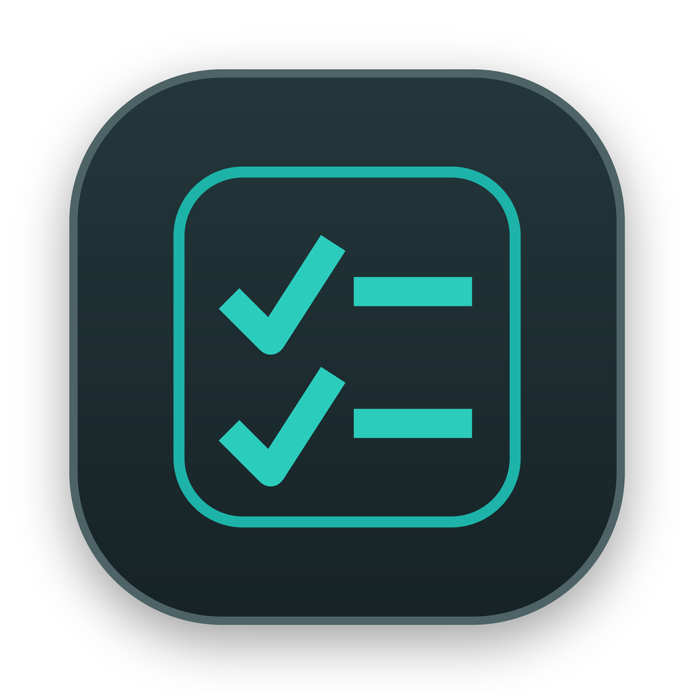
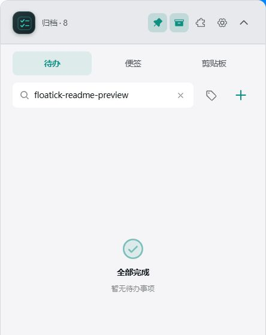
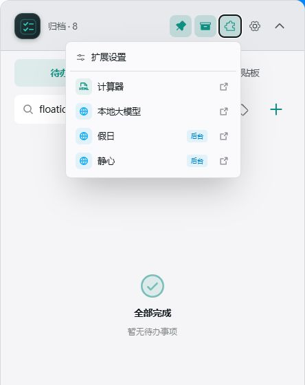
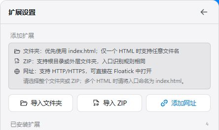
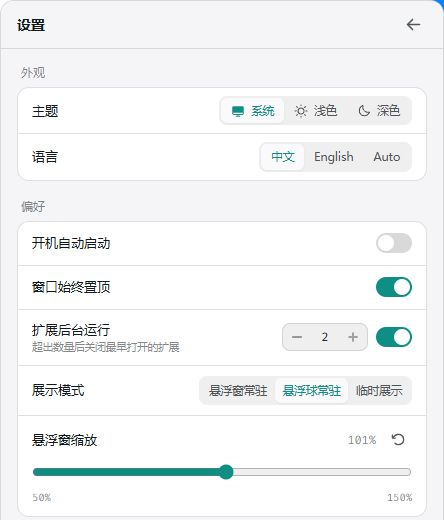

<div align="center">
  <h1>
    
    Floatick
  </h1>
  <p><strong>A local-first floating productivity workspace for macOS and Windows</strong></p>
  <p>Todos · Markdown notes · Clipboard history · Local and web extensions</p>
  <p>
    <a href="https://github.com/sxlisme/floatick/actions/workflows/ci.yml">
      
    </a>
    <a href="https://github.com/sxlisme/floatick/releases/latest">
      
    </a>
    
    
    
    <a href="./LICENSE"></a>
  </p>
  <p><strong>English</strong> · <a href="./README.zh-CN.md">简体中文</a></p>
</div>

## Screenshots

<table>
  <tr>
    <td width="50%" align="center">
      
      <br /><sub>Main workspace and search</sub>
    </td>
    <td width="50%" align="center">
      
      <br /><sub>Local and URL extensions with background state</sub>
    </td>
  </tr>
  <tr>
    <td width="50%" align="center">
      
      <br /><sub>Folder, ZIP, and URL extension import</sub>
    </td>
    <td width="50%" align="center">
      
      <br /><sub>Appearance, presentation mode, scaling, and background limits</sub>
    </td>
  </tr>
</table>

Floatick stays in the macOS menu bar or Windows notification area and opens as a compact floating workspace. It is designed for quick capture and repeated daily use without an account or a built-in cloud service.

## Features

### Todos and notes

- Create, search, tag, complete, archive, and restore todos and notes.
- Add deadlines and reminders while keeping completed work available in the archive.
- Write with a TipTap-based Markdown editor that supports headings, lists, task lists, links, quotes, code, images, and tables.
- Paste GitHub Flavored Markdown tables, use the formatting toolbar, or type `/` to insert common blocks.
- Preview rendered Markdown and copy todo content as Markdown.

### Clipboard history

- Automatically records plain-text clipboard history on macOS and Windows.
- Search, select, copy, delete, and favorite saved clips.
- Non-favorite clips expire after 7 days; favorites are retained until removed.

### Floating workspace

- Use a persistent panel, persistent floating ball, or transient tray panel.
- Remembers the last valid panel and floating-ball positions across launches.
- Supports window pinning, 50%-150% panel scaling, launch at login, light/dark/system themes, and Chinese/English UI.
- Runs as a single app instance; launching Floatick again brings the existing window to the foreground.

### Extensions

- Import a folder or ZIP containing `index.html`.
- If no `index.html` exists, a folder with exactly one `.html` or `.htm` file uses that file as its entry.
- Add HTTP or HTTPS pages as URL extensions.
- Rename extensions, distinguish local and web sources, and open either source in the system browser.
- Imported local pages receive Floatick theme tokens and theme-change events.
- Visited extensions can remain mounted in the background so switching views does not reset their state.
- Configure `0-20` background extensions. `0` disables background sessions; exceeding the limit closes the oldest background page first.
- Uses the operating system webview: WebView2 on Windows and WKWebView on macOS. Extension iframes allow Screen Wake Lock where the webview and page support it.

## Download

Permanent installers are published in [GitHub Releases](https://github.com/sxlisme/floatick/releases/latest):

- [Download Floatick for Windows (x64 setup)](https://github.com/sxlisme/floatick/releases/latest/download/Floatick-windows-x64-setup.exe)
- [Download Floatick for macOS (Universal DMG)](https://github.com/sxlisme/floatick/releases/latest/download/Floatick-macos-universal.dmg)

CI artifacts are intended for temporary test builds. Stable release assets remain attached to the corresponding GitHub Release.

On macOS, if Gatekeeper blocks the first launch, open **System Settings → Privacy & Security** and choose **Open Anyway** for Floatick.

## Shortcuts

| Action | macOS | Windows |
| --- | --- | --- |
| New todo or note | `⌘N` | `Ctrl+N` |
| Save editor | `⌘Enter` | `Ctrl+Enter` |
| Focus search | `⌘F` | `Ctrl+F` |
| Todos / Notes / Clipboard | `⌘1` / `⌘2` / `⌘3` | `Ctrl+1` / `Ctrl+2` / `Ctrl+3` |
| Open settings | `⌘,` | `Ctrl+,` |
| Close the current view or hide the panel | `Esc` | `Esc` |

## Local Data and Privacy

Floatick stores its own data as readable JSON under `~/.floatick`:

| Path | Purpose |
| --- | --- |
| `todos.json` | Todos, completion state, deadlines, reminders, and archives |
| `notes.json` | Notes and note metadata |
| `tags.json` | Shared todo and note tags |
| `clipboard.json` | Plain-text clipboard history and favorites |
| `settings.json` | Appearance and behavior preferences |
| `window-state.json` | Saved panel and floating-ball positions |
| `extensions.json` and `extensions/` | Extension registry and imported local files |

Floatick does not require an account and does not include cloud sync. Imported local extensions stay on the device. URL extensions are web pages and may communicate with their own servers according to those pages' behavior.

## Development

Requirements: Node.js 22+, pnpm 11+, the stable Rust toolchain, and the platform prerequisites listed in the [Tauri documentation](https://v2.tauri.app/start/prerequisites/).

```bash
pnpm install --frozen-lockfile
pnpm tauri:dev
```

Useful checks:

```bash
pnpm build
cargo test --manifest-path src-tauri/Cargo.toml --locked
cargo clippy --manifest-path src-tauri/Cargo.toml --all-targets --locked -- -D warnings
```

Create a native installer for the current platform with `pnpm tauri:build`. Windows NSIS installers are written under `src-tauri/target/release/bundle/nsis/`; macOS bundles are written under `src-tauri/target/release/bundle/`.

## License

Floatick is released under the [MIT License](./LICENSE).
