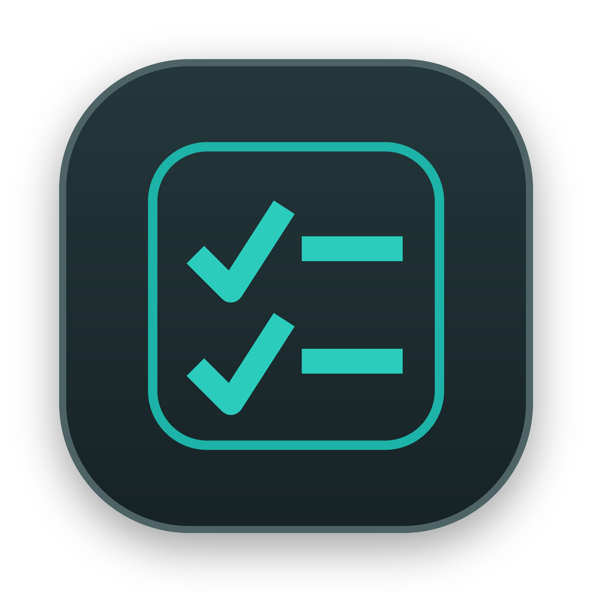
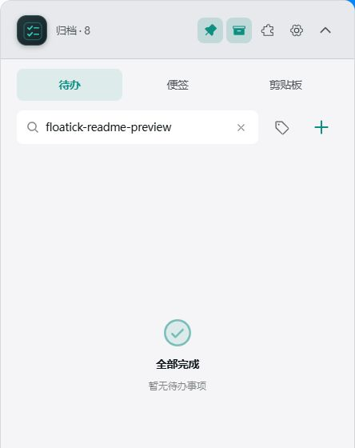
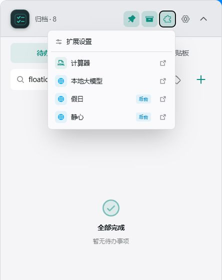
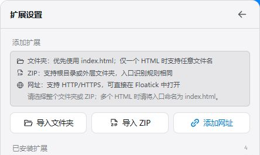
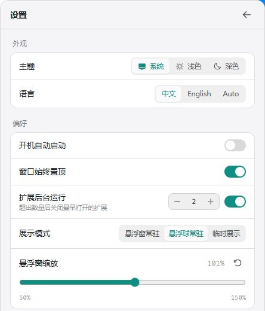

<div align="center">
  <h1>
    
    Floatick
  </h1>
  <p><strong>支持 macOS 与 Windows 的本地优先悬浮效率工作台</strong></p>
  <p>待办 · Markdown 便签 · 剪贴板历史 · 本地与网页扩展</p>
  <p>
    <a href="https://github.com/sxlisme/floatick/actions/workflows/ci.yml">
      
    </a>
    <a href="https://github.com/sxlisme/floatick/releases/latest">
      
    </a>
    
    
    
    <a href="./LICENSE"></a>
  </p>
  <p><a href="./README.md">English</a> · <strong>简体中文</strong></p>
</div>

## 界面预览

<table>
  <tr>
    <td width="50%" align="center">
      
      <br /><sub>主工作区与快速搜索</sub>
    </td>
    <td width="50%" align="center">
      
      <br /><sub>本地与网页扩展、后台运行状态</sub>
    </td>
  </tr>
  <tr>
    <td width="50%" align="center">
      
      <br /><sub>从文件夹、ZIP 或网址添加扩展</sub>
    </td>
    <td width="50%" align="center">
      
      <br /><sub>主题、展示模式、缩放与扩展后台数量</sub>
    </td>
  </tr>
</table>

Floatick 常驻于 macOS 菜单栏或 Windows 通知区域，点击即可展开紧凑的悬浮工作区。它面向随手记录和高频日常使用，无需注册账号，也不依赖内置云服务。

## 功能

### 待办与便签

- 支持新建、搜索、标签、完成、归档与恢复待办和便签。
- 待办可设置截止时间和提醒，完成后仍可在归档中查找。
- 基于 TipTap 的 Markdown 编辑器支持标题、列表、任务清单、链接、引用、代码、图片和表格。
- 支持粘贴 GitHub Flavored Markdown 表格，也可通过工具栏或 `/` 命令插入常用内容块。
- 支持 Markdown 预览和一键复制待办 Markdown。

### 剪贴板历史

- 在 macOS 与 Windows 上自动记录纯文本剪贴板历史。
- 支持搜索、多选、复制、删除和收藏。
- 普通记录保留 7 天；收藏记录会一直保留，直到用户主动删除。

### 悬浮工作区

- 提供悬浮窗常驻、悬浮球常驻和临时托盘面板三种展示模式。
- 自动记住悬浮窗与悬浮球上次有效位置。
- 支持窗口置顶、50%-150% 缩放、开机自启、跟随系统/浅色/深色主题以及中英文界面。
- 应用为单例运行；再次点击快捷方式会将已经运行的窗口带到最前端。

### 扩展

- 可导入包含 `index.html` 的文件夹或 ZIP。
- 没有 `index.html` 时，如果目录内只有一个 `.html` 或 `.htm` 文件，会自动使用该文件作为入口。
- 可直接添加 HTTP 或 HTTPS 网页地址。
- 支持重命名扩展、区分本地页面与网页，并在系统浏览器中打开对应内容。
- 导入的本地页面会收到 Floatick 主题变量和主题切换事件。
- 已访问的扩展可以保留在后台，切换页面时不会重置运行状态。
- 后台扩展数量可设置为 `0-20`：`0` 表示关闭后台；超过数量时优先关闭最早进入后台的页面。
- Windows 使用系统 WebView2，macOS 使用 WKWebView。扩展页面在 WebView 与网页本身支持时可使用 Screen Wake Lock。

## 下载

正式安装包永久保存在 [GitHub Releases](https://github.com/sxlisme/floatick/releases/latest)：

- [下载 Windows x64 安装程序](https://github.com/sxlisme/floatick/releases/latest/download/Floatick-windows-x64-setup.exe)
- [下载 macOS Universal DMG](https://github.com/sxlisme/floatick/releases/latest/download/Floatick-macos-universal.dmg)

CI Artifact 主要用于临时测试；正式版安装包会长期附加在对应的 GitHub Release 中。

macOS 首次启动若被 Gatekeeper 拦截，请前往 **系统设置 → 隐私与安全**，为 Floatick 选择 **仍要打开**。

## 快捷键

| 操作 | macOS | Windows |
| --- | --- | --- |
| 新建待办或便签 | `⌘N` | `Ctrl+N` |
| 保存编辑内容 | `⌘Enter` | `Ctrl+Enter` |
| 聚焦搜索 | `⌘F` | `Ctrl+F` |
| 待办 / 便签 / 剪贴板 | `⌘1` / `⌘2` / `⌘3` | `Ctrl+1` / `Ctrl+2` / `Ctrl+3` |
| 打开设置 | `⌘,` | `Ctrl+,` |
| 关闭当前页面或收起面板 | `Esc` | `Esc` |

## 本地数据与隐私

Floatick 自身数据以可读 JSON 格式保存在 `~/.floatick`：

| 路径 | 用途 |
| --- | --- |
| `todos.json` | 待办、完成状态、截止时间、提醒与归档 |
| `notes.json` | 便签与便签元数据 |
| `tags.json` | 待办和便签共用的标签 |
| `clipboard.json` | 纯文本剪贴板历史与收藏状态 |
| `settings.json` | 外观与行为偏好 |
| `window-state.json` | 悬浮窗和悬浮球的位置 |
| `extensions.json` 与 `extensions/` | 扩展注册信息和导入的本地文件 |

Floatick 无需账号，也没有内置云同步。导入的本地扩展保存在设备上；URL 扩展属于网页，可能按照网页自身逻辑与其服务器通信。

## 本地开发

需要 Node.js 22+、pnpm 11+、稳定版 Rust 工具链，以及 [Tauri 文档](https://v2.tauri.app/start/prerequisites/)列出的当前平台依赖。

```bash
pnpm install --frozen-lockfile
pnpm tauri:dev
```

常用检查：

```bash
pnpm build
cargo test --manifest-path src-tauri/Cargo.toml --locked
cargo clippy --manifest-path src-tauri/Cargo.toml --all-targets --locked -- -D warnings
```

执行 `pnpm tauri:build` 可生成当前平台的原生安装包。Windows NSIS 安装程序位于 `src-tauri/target/release/bundle/nsis/`，macOS 产物位于 `src-tauri/target/release/bundle/`。

## 开源协议

Floatick 基于 [MIT License](./LICENSE) 开源。
